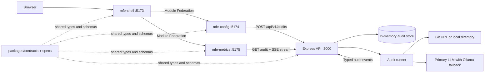

# Sentinel SDD

Sentinel SDD is a spec-driven proof of concept for auditing a local or Git-hosted code repository. An Express API reads a bounded set of source files, sends snippets through an LLM adapter, and streams audit activity and findings to a React microfrontend dashboard over Server-Sent Events (SSE).

This repository demonstrates a TypeScript monorepo, runtime microfrontend composition, contract-first API development, and an asynchronous audit lifecycle. It is a PoC, not a production security scanner: findings depend on the configured model and the files/rules selected for analysis.

## Current Implementation

- `mfe-shell` hosts the UI and owns routes: `/` for configuration and `/audits/:auditId` for metrics.
- `mfe-config` validates and submits Git URL or local path, enabled rule sets, and a severity threshold.
- `mfe-metrics` consumes the named SSE events and displays the event timeline, findings, severity counts, and terminal health score.
- `apps/api` implements audit creation, session-scoped audit retrieval, and the per-audit SSE stream. The runner reads a local directory or shallow-clones a Git repository, then calls the configured LLM adapter with Ollama fallback.
- `packages/contracts` contains generated TypeScript API/event types, API client helpers, fixtures, and contract validation derived from `/specs`.

## Architecture



### Request and Event Flow

1. The configuration remote sends `POST /api/v1/audits`; the API validates the request, stores a queued audit, and starts the runner asynchronously.
2. The shell navigates to `/audits/:auditId`; the metrics remote opens `GET /api/v1/audits/:auditId/stream` using the browser's native `EventSource`.
3. The runner acquires repository files, inspects snippets, and emits `AGENT_THOUGHT`, `TOOL_EXECUTION`, `VULNERABILITY_FOUND`, and terminal `AUDIT_COMPLETED` events.
4. The SSE hub validates and sequences events, buffers them for reconnect/replay, and updates the in-memory audit snapshot.

The hub assigns monotonically increasing per-audit event IDs. Streams for unknown audit IDs return a Problem Details 404 before SSE headers are sent. LLM/provider failures are represented as stream events, not HTTP errors.

### Technology

| Area                 | Current implementation                                                                 |
| -------------------- | -------------------------------------------------------------------------------------- |
| Runtime and language | Node.js 20+, TypeScript 5, ESM                                                         |
| Monorepo             | pnpm 9 workspaces, Turborepo 2                                                         |
| Frontend             | React 18, Vite 5, Tailwind CSS 3                                                       |
| Microfrontends       | `@originjs/vite-plugin-federation`; shell host plus config and metrics remotes         |
| API                  | Express 4, Ajv 8, RFC 9457 Problem Details                                             |
| Streaming            | Native SSE with ordered IDs, bounded replay, and `Last-Event-ID` support on the server |
| Contracts            | OpenAPI 3.1, JSON Schema draft-07, generated TypeScript types                          |
| Tests                | Vitest, Testing Library, Supertest; MSW fixtures/helpers in the contracts package      |

## Repository Layout

```text
apps/
  api/                 Express API, agent runner, stores, and SSE hub
  mfe-shell/           Federation host, layout, and routing
  mfe-config/          Audit launch remote
  mfe-metrics/         Live stream and findings remote
packages/
  contracts/           Generated API/event types, validation, fixtures, and mocks
specs/
  openapi.yaml         REST contract
  events-schema.json   SSE event contract
docs/
  PROJECT_BRIEF.md     Product goals and original scope
  ARCHITECTURE.md      High-level design
  asd/                 Architecture Specification Document sections
  adr/                 Accepted architecture decisions
  plans/               Implementation plans and acceptance criteria
scripts/
  dev-federation.mjs   Local MFE federation orchestration
```

## Getting Started

Prerequisites: Node.js `>=20`, pnpm `9.12.0` (or compatible pnpm 9), and Git. Install dependencies from the repository root:

```sh
pnpm install
```

Start the frontend and API in separate terminals. The root `pnpm dev` command builds the remotes, serves them on ports 5174 and 5175, and starts the shell on port 5173; it does not start the API.

```sh
# Terminal 1: shell and federated remotes
pnpm dev

# Terminal 2: API at http://localhost:3000/api/v1
pnpm --filter @sentinel/api dev
```

Open `http://localhost:5173`. The frontend defaults to `http://localhost:3000/api/v1`; override with `VITE_API_BASE_URL` when using a different API URL.

### LLM Configuration

Local Ollama is the default provider. It uses `OLLAMA_URL` (default `http://localhost:11434`) and model `llama3.2`. A non-loopback `OLLAMA_URL` is rejected unless external LLM access is explicitly enabled.

To enable a remote HTTP provider as the primary, set `SENTINEL_ALLOW_EXTERNAL_LLM=true`, `SENTINEL_LLM_ENDPOINT`, and `SENTINEL_LLM_MODEL`. The endpoint must be an absolute HTTP(S) URL without embedded credentials and return a compatible JSON completion response. When enabled, local Ollama remains the fallback. Without the opt-in flag, remote endpoint settings are ignored and only local Ollama is used.

The API also supports `PORT` (default `3000`) and `ALLOWED_ORIGINS` (comma-separated browser origins; defaults to the three local MFE ports). The PoC has no authentication. Do not expose it to untrusted networks or audit source code you are not permitted to share with the configured model provider.

### Source and Secret Handling

The API excludes these paths before reading repository files:

- `.env`, `.env.*`, and `.env-*` files.
- The `.aws`, `.azure`, `.docker`, `.gnupg`, `.kube`, `.ssh`, `credentials`, and `secrets` directories.
- Credential/config filenames `.dockercfg`, `.git-credentials`, `.netrc`, `.npmrc`, `.pypirc`, `application_default_credentials.json`, `auth.json`, `credentials`, `credentials.json`, and `kubeconfig`; service-account JSON files are excluded too.
- Private-key names (`id_rsa`, `id_dsa`, `id_ecdsa`, `id_ed25519`, and names containing `private-key`, `private_key`, or `privatekey`), filenames containing a delimited `credential(s)` or `secret(s)` component, and certificate/key files ending in `.cer`, `.cert`, `.crt`, `.der`, `.jks`, `.keystore`, `.key`, `.p12`, `.p7b`, `.p7c`, `.pem`, `.pfx`, `.pkey`, `.ppk`, `.tfvars` (including `.tfvars.json`), or `.tfstate`.

Before any LLM adapter sends a prompt—including local Ollama—the API uses the offline `@secretlint/core` 13.1.x engine with `@secretlint/secretlint-rule-preset-recommend` and replaces detected ranges with `[REDACTED]`. Source-controlled Secretlint ignore comments are disabled so repository content cannot suppress detection. The same detector sanitizes generated finding fields, audit diagnostics, and log messages. Its recommended rules cover provider credentials and patterns for AWS, GCP, private keys, NPM, Basic Auth, Slack, SendGrid, Shopify, Stripe, GitHub, GitLab, Grafana, OpenAI, Anthropic, Groq, Hugging Face, Linear, Notion, 1Password, database connection strings, HashiCorp Vault, Vercel, Databricks, Docker, Figma, Cloudflare, and Tailscale.

If scanning fails or returns invalid ranges, the snippet is skipped and the original content is never sent. This is a baseline, not a guarantee: custom, novel, encoded, or otherwise unrecognized secrets can remain undetected. Review repository contents and provider egress settings before each audit; external providers receive the redacted prompt only when explicitly enabled.

## Development Commands

```sh
pnpm lint
pnpm typecheck
pnpm test
pnpm build
```

Run checks for a single workspace with, for example:

```sh
pnpm --filter @sentinel/api test
pnpm --filter @sentinel/mfe-metrics test
pnpm --filter @sentinel/contracts validate
```

## Contracts and Documentation

- Treat `specs/openapi.yaml` and `specs/events-schema.json` as the REST/SSE contract source. Regenerate shared types after changing either spec with `pnpm --filter @sentinel/contracts generate:api` and/or `generate:events`, then run `pnpm --filter @sentinel/contracts validate` and the relevant workspace tests.
- `docs/asd/` records business context, requirements, constraints, and architecture principles. Start with [`docs/asd/ASD.md`](docs/asd/ASD.md), then load the relevant section.
- `docs/adr/` captures accepted decisions; read the ADRs relevant to an area before changing its behavior.
- `docs/plans/` contains detailed implementation plans and acceptance criteria.
- [`docs/ARCHITECTURE.md`](docs/ARCHITECTURE.md) provides the high-level system design and component interactions.
