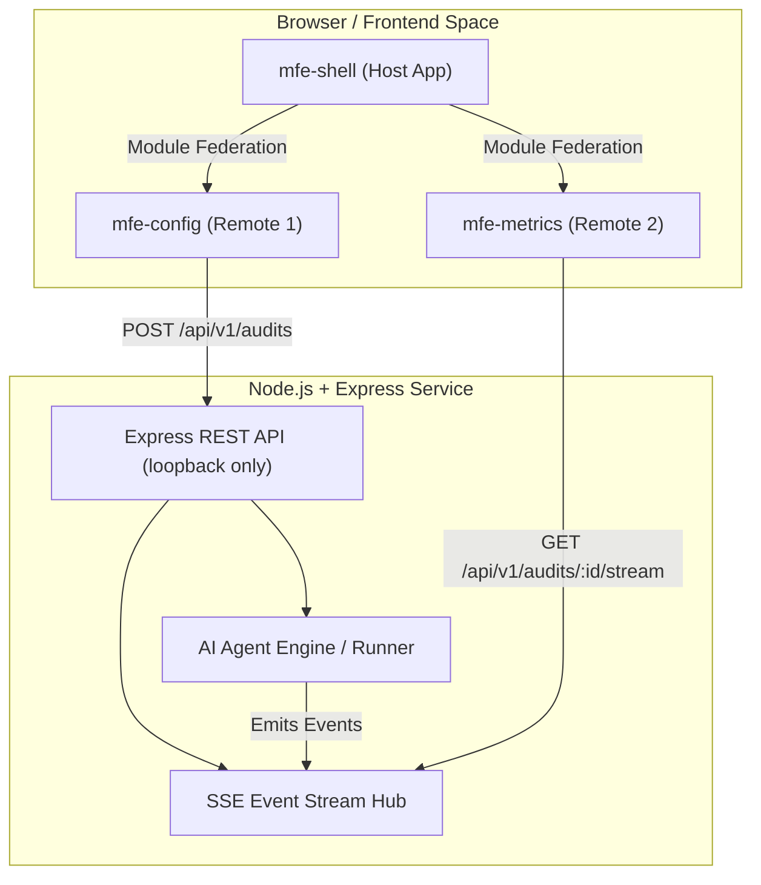
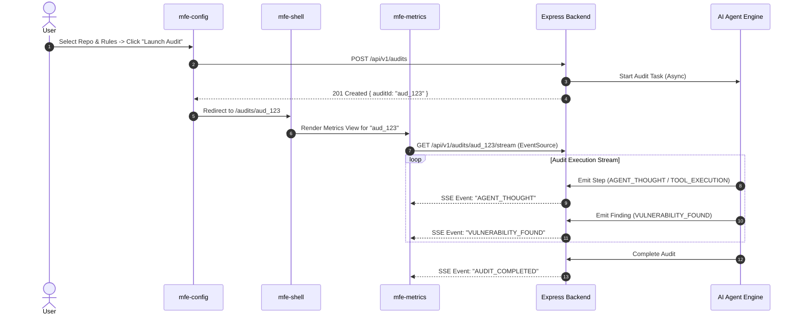

# 🏛️ System Architecture & Design Specification

This document details the architectural design for **Sentinel SDD**, specifying the Microfrontend (MFE) topology, real-time data flow, testing strategy, and backend execution engine.

---

## 1. High-Level Architecture Overview

Sentinel SDD is built as a **TypeScript Monorepo** leveraging `pnpm` Workspaces and `Turborepo`. The system decouples the user interface into independent Microfrontends and connects to a Node.js/Express backend that streams AI Agent events via Server-Sent Events (SSE).

### Security and Privacy Boundaries

The unauthenticated PoC API is restricted to loopback and must not be exposed to a LAN or shared environment. Local repository audits are limited to canonicalized roots configured by `SENTINEL_ALLOWED_REPO_ROOTS`; path and symlink escapes are rejected. Local Ollama is the default LLM. External providers require explicit server-operator opt-in, and known sensitive files/secrets are excluded or redacted before any provider call. See [ADR-008](adr/ADR-008-local-only-repository-and-llm-boundaries.md) and the [ASD security requirements](asd/03-nfr.md).

## 2. Microfrontend (MFE) Strategy

The frontend uses Vite + @originjs/vite-plugin-federation to enable runtime Module Federation.

### Microfrontend Topology

- **`mfe-shell` (Host / Container):** React layout, routing, remote loading and error handling with React Router.
- **`mfe-config` (Remote 1):** React audit configuration form, local state and fail-fast validation, using the contracts API client.
- **`mfe-metrics` (Remote 2):** React live event stream, findings, health score and severity distribution (Recharts), and terminal Markdown export.

### Runtime Communication & State

- **Inter-MFE Navigation:** Controlled by `mfe-shell` routing.
- **REST state:** local React state and fetch; no shared query cache. Config uses the contracts API client; metrics fetches snapshots for reconciliation.
- **Event Streaming:** `mfe-metrics` uses `useAuditStream` with native `EventSource`, ordered deduplication and snapshot reconciliation. `AGENT_THOUGHT` is a progress/status event, not internal model reasoning.
- **Remediation:** Before/After snippets are suggestions for manual application outside Sentinel. No Apply Fix, file mutation, patch download, PR or commit is provided.

---

## 3. Real-Time Communication Flow (SSE)

Real-time feedback is achieved using Server-Sent Events (SSE), establishing a lightweight, unidirectional streaming pipe from the Node.js backend to the browser.

## 4. Backend Architecture (Node.js + Express)

The backend is a lightweight Node.js service written in TypeScript.

### Core Modules

- **`routes/api-v1.ts`**: Mounts versioned routes and the internal `/api/v1/health` process smoke check; it is not a provider-readiness check.
- **`routes/audits.ts`**: Handles audit creation, snapshot retrieval and SSE subscriptions, including 404 responses before stream headers.
- **`sse/hub.ts` and `sse/serializer.ts`**: Validate, sequence, buffer and deliver events with SSE framing and replay.
- **`agent/runner.ts`**: Manages execution flow, reading local code files or invoking CLI/LLM tools, emitting formatted event objects conforming to `specs/events-schema.json`.

---

## 5. Comprehensive Testing Strategy (Testing Trophy)

Quality assurance follows a strict pyramid/trophy approach, ensuring code resilience at every layer:

1. **Mock Service Worker (MSW):** Contract-package mocks and fixtures support isolated API testing; client tests also use deterministic fetch and EventSource mocks.
2. **Unit & Integration Testing (Vitest + React Testing Library):** Target Coverage >80% on critical domain hooks, utilities, and components.
3. **End-to-End Testing (Playwright):** `pnpm test:e2e:flow` runs the three MFEs and API with a deterministic test-only runner; it checks the config → shell → metrics flow, Markdown download and standalone metrics. `pnpm test:e2e:latency` separately checks P1 browser latency.

Run `pnpm validate` for the root contract gate. For development, `pnpm dev` starts only the MFEs; run `pnpm --filter @sentinel/api dev` in a separate terminal.
