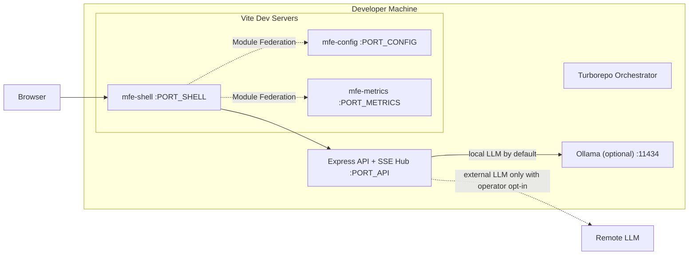

# 7. Infrastructure Architecture

> Driven by constraints C-06 ($0 budget) and C-07 (15-day PoC). No cloud infrastructure in scope.

## 7.1 Environment Model

| Environment             | Type     | Managed by     | Purpose                            |
| ----------------------- | -------- | -------------- | ---------------------------------- |
| Local developer machine | Dev only | Each developer | Full stack execution (`turbo dev`) |

Single environment. No UAT/Staging/Prod environments for the MVP — the deliverable is a locally-run PoC (constraint C-06/C-07; confirmed by user decision "in-memory MVP, no external DB").

## 7.2 Runtime Topology (Local)

## 7.3 Networking & Communication

- All communication over loopback HTTP during development. The unauthenticated Express API binds only to a loopback address; do not rely on `localhost` in its log message or on CORS to enforce this boundary.
- Vite dev server ports configured per MFE; Module Federation remotes resolved by URL at runtime.
- SSE endpoints follow standard HTTP semantics (`text/event-stream`, `no-cache`, keep-alive).
- No TLS, no reverse proxy, no CDN — out of scope for PoC.
- Any non-loopback/shared deployment is prohibited until a separate authentication, authorization, and transport-security design is approved.

## 7.4 Environment Dependencies

| Dependency             | Required                       | Notes                                                                                                                                                                                            |
| ---------------------- | ------------------------------ | ------------------------------------------------------------------------------------------------------------------------------------------------------------------------------------------------ |
| Node.js ≥ 20           | Yes                            | Runtime for backend and all tooling                                                                                                                                                              |
| pnpm + Turborepo       | Yes                            | Workspace + task orchestration                                                                                                                                                                   |
| LLM access             | Local Ollama by default        | A remote provider is disabled unless the server operator sets `SENTINEL_ALLOW_EXTERNAL_LLM=true`; remote credentials must be supplied through server-side secret configuration and never logged. |
| Local repository roots | Required for local-path audits | `SENTINEL_ALLOWED_REPO_ROOTS` is a comma-separated list. Unset/empty disables local-path audits; resolved paths and symlink targets must remain within a configured root.                        |
| Git                    | Yes                            | Cloning audited repositories                                                                                                                                                                     |
| Docker                 | Optional                       | Only if the team prefers containerized local runs; not required by the architecture                                                                                                              |

## 7.5 Future Environments (out of MVP scope)

> **[TO BE DEFINED]** — If the PoC graduates to a shared/deployed environment: hosting target (single VM vs. container platform), authentication/authorization, TLS termination, and CI-driven deployment. The local no-auth configuration must not be reused for such an environment. See `09-devops.md` §9.4.
